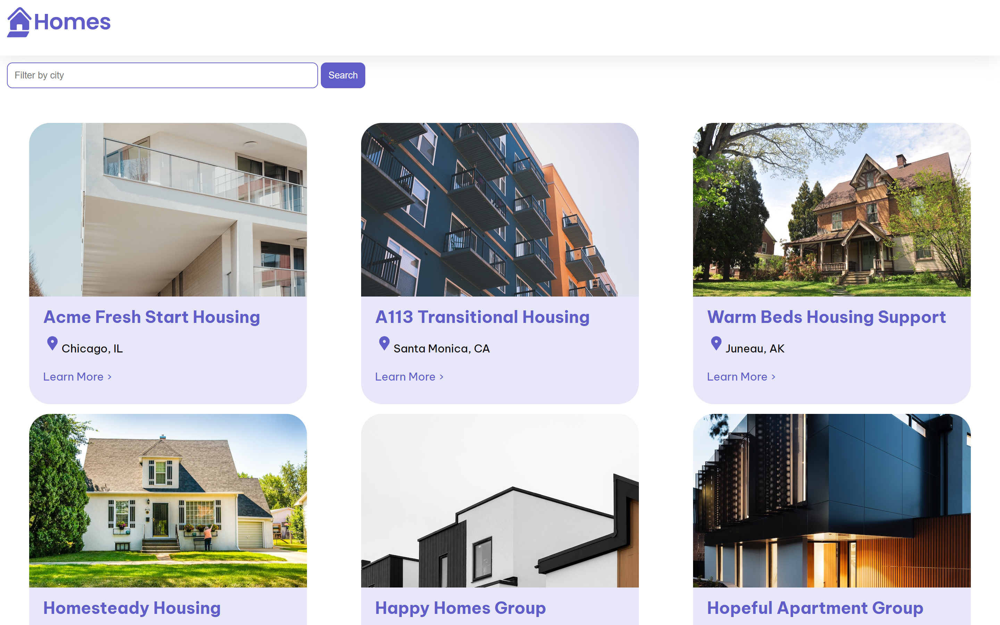
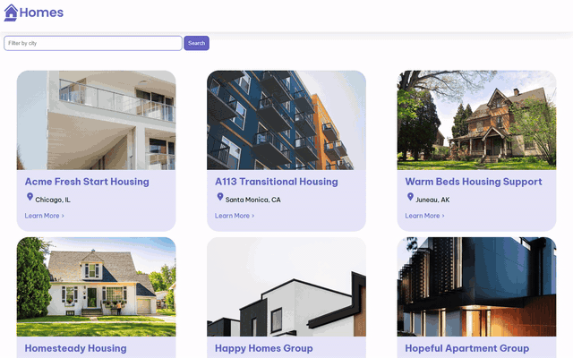

# Homes

A small housing-listings app built with Angular 22 while following the official Angular
"first app" tutorial. Browse homes, filter them by city, open a listing's details and
apply to live there.

## App Showcase

**Landing state**



**Demo**



▶ **Full-quality video:** [assets/homes-app-demo.mp4](assets/homes-app-demo.mp4) (H.264, 2880×1800, 30 fps, 22 s). The GIF above is the same recording, downscaled, because GitHub doesn't play videos stored in the repository inline.

**What the demo shows, in order:**

1. **Listings:** the home page loads all 10 homes, then scrolls down through the grid and back up.
2. **Filter by city:** typing "Oakland" and clicking **Search** narrows the grid to the four Oakland homes.
3. **Learn More:** opens the details page with the photo, location, units available, wifi and laundry.
4. **Apply now:** the First Name, Last Name and Email fields are filled in and submitted.
5. **Logo:** clicking the Homes logo returns to the full list.

### UI/UX features: technical summary

| Area | Implementation |
| --- | --- |
| **Components** | Standalone components (`Home`, `HousingLocation`, `Details`) with inline templates. Each one lists what it uses in its own `imports`. |
| **Passing data down** | `HousingLocation` receives its house through a signal input, `input.required<HousingLocationInfo>()`, and reads it in the template as `housingLocation()`. |
| **Rendering the list** | `@for (...; track $index)` control flow renders one card per home. |
| **Data loading** | `HousingService` uses `fetch` to load `/public/locations.json`, a static file, so the app needs no backend. `Home` and `Details` set their data in `.then(...)` and call `ChangeDetectorRef.markForCheck()` so Angular re-renders once the data arrives. |
| **Filtering** | A template reference variable (`#filter`) passes the input's value to `filterResults()` on `(click)`. The method uses a case-insensitive `Array.filter` on `city`. An empty search restores the full list. |
| **Routing** | `provideRouter` with two routes: `''` → `Home` and `details/:id` → `Details`, each with a page `title`. Cards link with `[routerLink]="['/details', id]"`, and `Details` reads the id from `ActivatedRoute.snapshot.params`. |
| **Application form** | Reactive forms: a `FormGroup` of three `FormControl`s bound with `[formGroup]` and `formControlName`. Submitting calls `HousingService.submitApplication()`, which currently only logs to the console. |
| **Styling** | CSS custom properties (`--primary-color`, `--accent-color`) and the Be Vietnam Pro font. The results grid uses `repeat(auto-fill, minmax(400px, 400px))`, with media queries that switch to two columns below 768 px and one column below 500 px. |

The screenshot and video were captured with Playwright driving Chrome at a 1440×900 viewport (screenshot at 2× device pixel ratio, video at 2× via the DevTools screencast) against the dev server.

## Running locally

```bash
npm install
npm start
```

Then open http://localhost:4200.

To make a production build, run `npm run build`. The output goes to `dist/first-app/browser`.

## Deploying to Vercel

- Set the Output Directory to `dist/first-app/browser`.
- `vercel.json` rewrites every route to `index.html`, so direct links such as `/details/3` work when the page is refreshed.
